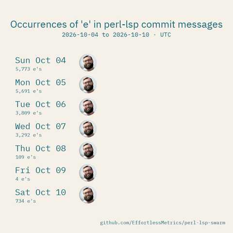

# e-balls

A GitHub Action that turns a week of [perl-lsp](https://github.com/EffortlessMetrics/perl-lsp) commit messages into a short race between days. Each day is a ball with an avatar; the more occurrences of `e` its commit messages have, the faster it goes. You get a GIF, an MP4, and the counts as JSON.



*Top 7 perl-lsp days in the past week, rendered with `since: 7d`.* [MP4](examples/perl-lsp-2026-10-04-teal/e-balls.mp4)

## Quick start

Copy [examples/weekly.yml](examples/weekly.yml) to `.github/workflows/e-balls.yml`. The workflow:

1. Counts the occurrences of `e` in each day's commit messages.
2. Renders the GIF and MP4 with the top contributor's GitHub avatar on every ball.
3. Uploads the media and daily counts as a workflow artifact.

Run it manually, or let it run every Monday. By default, the avatar belongs to the non-bot author who contributed the most `e`s that week; `avatar` overrides it. The first run builds the Rust binaries, and later runs reuse the cached binaries.

## Render without publishing

To render on demand and download the files as a workflow artifact, use [examples/artifacts.yml](examples/artifacts.yml):

```yaml
- uses: EffortlessSteven/e-balls@main
  id: balls
  with:
    repository: EffortlessMetrics/perl-lsp-swarm
    project: perl-lsp
    since: 7d
    format: both

- uses: actions/upload-artifact@v4
  with:
    name: e-balls-media
    path: ${{ steps.balls.outputs.directory }}
```

## Race a time window

Set `since: 7d` to count the last seven completed UTC days. The title reads "Occurrences of 'e' in perl-lsp commit messages". Set `end` to pin the week to a past UTC date.

```yaml
- uses: EffortlessSteven/e-balls@main
  with:
    since: 7d
```

## Inputs

| Input | Default | What it does |
| --- | --- | --- |
| `repository` | current repository | Public `owner/repo` to read Git history from. |
| `ref` | default branch | Source branch or a reachable full commit SHA. |
| `since` | `7d` | Last seven completed UTC days. |
| `end` | today (UTC) | Optional exclusive UTC end date, such as `2026-10-11`. |
| `letter` | `e` | ASCII letter to count, case-insensitively. |
| `project` | source repository name | Project name shown in the title. |
| `avatar` | top contributor's GitHub avatar | Optional local PNG/JPEG override for every ball. |
| `data` | unset | Re-render saved counts without reading Git (requires `avatar`). |
| `token` | `github.token` | Read-only GitHub account lookup for the selected contributor. |
| `format` | `both` | `gif`, `mp4`, or `both`. |
| `output` | `e-balls-output` | New output directory. |
| `asset-base-url` | unset | Optional URL prefix for links in `embed.md`. |

## Outputs

All outputs are paths on the runner.

| Output | Contents |
| --- | --- |
| `directory` | All generated files, including GIF and/or MP4. |
| `markdown` | `embed.md`, with links to the rendered media. |
| `manifest` | `manifest.json` with the counts and generated files. |
| `data` | `data.json`, with daily counts and per-commit receipts. |

To use the files in another job, upload `directory` as an artifact.

## What gets counted

- Only `e` and `E` in full commit messages count.
- A commit in several merged branches counts once.
- All authors' commits count. The avatar comes from the non-bot author with the most counted letters, resolving their GitHub account.
- The seven days are shown in calendar order, using UTC committer dates. Empty days stay still.
- The fastest ball crosses in one second, so speeds are relative within a clip. Clips last 16 seconds. MP4 is 1080px at 60fps; GIF is 480px at 15fps.

## Run it locally

Needs Rust 1.88+, Git, FFmpeg, and FreeType headers (`libfreetype6-dev` and `pkg-config` on Ubuntu).

```sh
cargo build --release --locked --bin e-balls --bin e-balls-collect

git clone --bare --filter=blob:none --single-branch --branch main --no-tags \
  https://github.com/EffortlessMetrics/perl-lsp-swarm.git ../perl-lsp-history.git

./target/release/e-balls-collect \
  --repo ../perl-lsp-history.git --ref HEAD \
  --repository EffortlessMetrics/perl-lsp-swarm --project perl-lsp \
  --since 7d --out data.json --avatar-out top-contributor.png

./target/release/e-balls --data data.json \
  --avatar top-contributor.png --format both
```

Files go to `out/`. Useful flags: `--days`, `--start`, and `--end` for other windows; `--width`, `--fps`, and `--duration` for rendering. Run `--help` for the rest.

## More

The original Release Balls action is available in [legacy](legacy/action.yml); see [release publishing details](docs/releases.md).

## License

[MIT](LICENSE). The bundled fonts are CC0 and SIL OFL 1.1; see [assets](assets/README.md).
